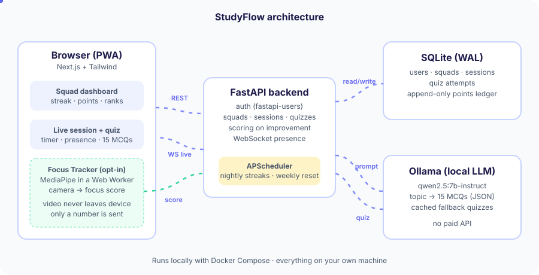
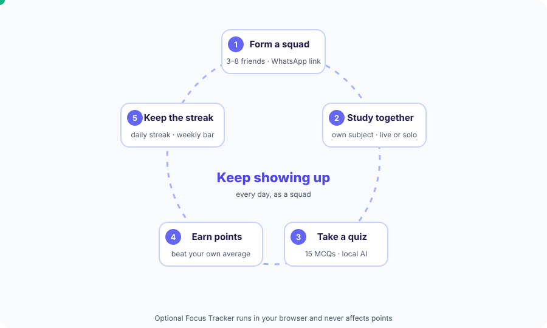

# StudyFlow

**Study together. Improve together. Keep showing up.**


---
StudyFlow is a research-backed, gamified social study app built for the hackathon theme `Engagement & Staying in the Learning Journey`. It helps students stay motivated and keep learning over time instead of dropping off.

Built local-first with FastAPI, Next.js, SQLite and Ollama. It uses no paid APIs and no hosted backend.
Designed by me and developed with [OpenAI Codex](https://openai.com/codex/) as my coding agent.

<p align="center">
  
</p>


## Why StudyFlow

Most learners don't quit because the material is too hard. They quit because it's hard to keep showing up alone. StudyFlow tackles this with three things that research links to [persistence](https://doi.org/10.1007/s11423-010-9177-y): [social accountability](https://doi.org/10.3102/0162373713500523), [regular routines](https://doi.org/10.1073/pnas.1921417117) and [visible personal progress](https://doi.org/10.1007/s10648-019-09498-w).

StudyFlow turns studying into a shared daily habit. Friends hold each other accountable through live sessions and a squad streak, a short quiz after every session shows each learner what they've retained, and points reward getting better rather than being the best, so everyone has a reason to come back tomorrow.

## How it works
<p align="center">
  
</p>

1. **Form a squad** of 3–8 friends with a WhatsApp-shareable link.
2. **Study together**, each on your own subject. Live sessions earn bonus points, and solo sessions still count.
3. **Take a 15-question quiz** on your topic, generated by a local AI.
4. **Earn points for improving** on your own average, never ranked on raw scores.
5. **Keep the streak going**, with two freezes a week for off days.

**Optional: Focus Tracker.** An opt-in camera check that runs entirely in your browser and never affects points.

## Quick start

Requires uv, Node.js 22+, npm, Ollama and make. Keep Ollama running.

```sh
ollama pull qwen2.5:7b-instruct
make setup
make migrate
make seed
make dev
```

Prefer Docker? Follow the [Docker setup](docs/setup.md#docker-option) for `.env` configuration and demo seeding, then run `docker compose up --build`.

Open [localhost:3000](http://localhost:3000). Demo login: `ada@demo.studyflow.example.com` / `StudyFlow-demo-2026!`.

## Docs

- [Setup, configuration and Docker](docs/setup.md)
- [2–3 minute demo](docs/demo.md) · [Demo data and resets](docs/demo-data.md)
- [Using StudyFlow](docs/usage.md) · [Testing](docs/testing.md)
- [Design and rules](docs/studyflow-design.md) · [Focus Tracker](docs/focus-tracker.md)
- [Limitations and backlog](docs/backlog.md)
- [Working on the project](AGENTS.md)
